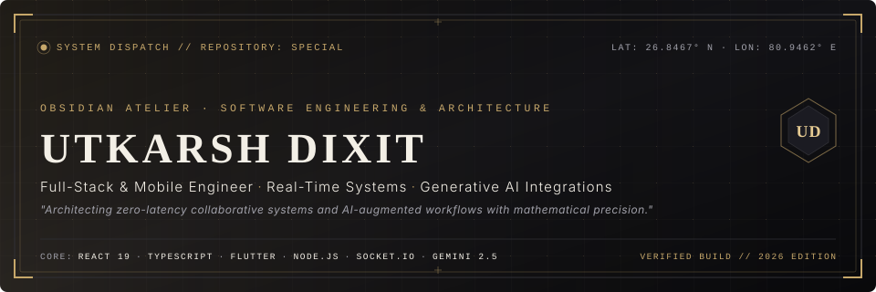
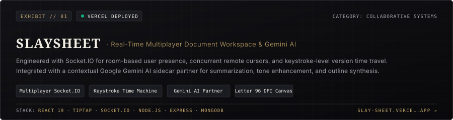
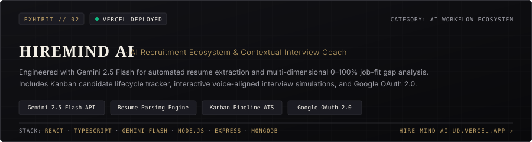
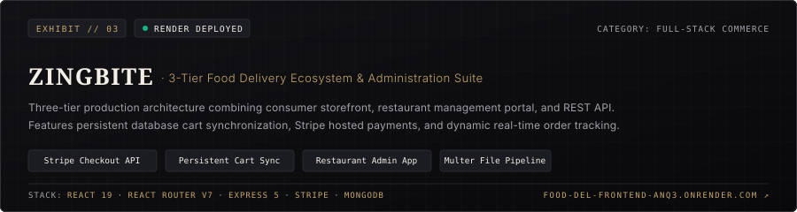
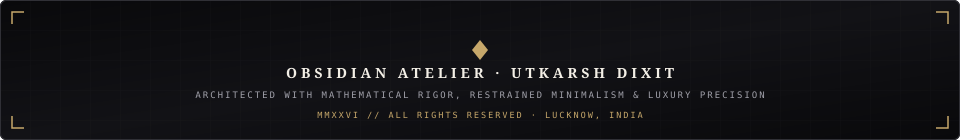

<div align="center">

<!-- ========================================================================= -->
<!-- 01 // SIGNATURE HERO BANNER & IDENTITY                                   -->
<!-- ========================================================================= -->



<br/><br/>

<!-- Refined Luxury Navigation Badges -->
<p align="center">
  <a href="https://linkedin.com/in/utkarshdixit9" target="_blank">
    
  </a>
  &nbsp;
  <a href="mailto:utkarshdixit925@gmail.com">
    
  </a>
  &nbsp;
  <a href="https://github.com/Utkarshdixit11" target="_blank">
    
  </a>
  &nbsp;
  <a href="https://slay-sheet.vercel.app/" target="_blank">
    
  </a>
  &nbsp;
  <a href="./Utkarsh_Dixit_Resume.pdf" target="_blank">
    
  </a>
</p>

<!-- Fine Architectural Gold Divider -->


</div>

<br/>

<!-- ========================================================================= -->
<!-- 02 // SYSTEM IDENTITY & PHILOSOPHY                                       -->
<!-- ========================================================================= -->


<br/>

> **"Software engineering is an architectural discipline. I build high-throughput, low-latency digital systems where mechanical sympathy meets cinematic user experience."**

I am a **Full-Stack and Mobile Systems Engineer** based in Lucknow, India. My engineering practice centers on **real-time multiplayer protocols** (WebSockets, Socket.IO), **Generative AI workflows** (Google Gemini API, RAG pipelines, contextual agents), and **client-side data processing engines**.

```
┌── SYSTEM DISPATCH // CREDENTIALS & CADENCE ───────────────────────────────────────────────┐
│ PRINCIPAL:      Utkarsh Dixit                                                             │
│ EDUCATION:      Bachelor of Computer Applications (2024–2027)                             │
│ INSTITUTION:    Shri Ramswaroop Memorial College of Management, Lucknow                   │
│ HONORS:         NIELIT Lucknow (MeitY, Govt. of India) — Grade 'S' (80%+) Full-Stack MERN │
│ HONORS:         NIELIT Lucknow (MeitY, Govt. of India) — Grade 'S' (80%+) Artificial Intel│
│ COMMERCIAL:     Shipped 7 Production Apps @ PanScience Innovations LLP                    │
│ DOMAIN FOCUS:   Real-Time Collaboration · Generative AI Systems · Cross-Platform Mobile   │
└───────────────────────────────────────────────────────────────────────────────────────────┘
```

#### Production Highlights & Track Record:
* **PanScience Innovations LLP (Dec 2025 – Mar 2026)**: Shipped production cross-platform mobile features for iOS and Android across commercial products, including **Botza** and **OwnChat** (Flutter with Gemini API + RAG over 100+ page documents). Engineered **Steno AI** (speech-to-text recording, transcription, and legal argument summarization for desktop).
* **NIELIT Lucknow — Ministry of Electronics & IT (Jun 2026 – Aug 2026)**: Completed 90-hour industrial training with top-tier **Grade S (80%+)**, engineering end-to-end REST APIs with Node.js/Express, component state trees in React, and persistent MongoDB/MySQL pipelines.
* **NIELIT Lucknow — Artificial Intelligence (Jun 2025 – Aug 2025)**: Completed 90-hour AI training with **Grade S (80%+)**, implementing speech recognition pipelines, scientific computing with NumPy/Pandas, and fundamental ML/NLP architectures.

<br/>

<div align="center">
  
</div>

<br/>

<!-- ========================================================================= -->
<!-- 03 // TECHNICAL ARSENAL & SYSTEMS                                        -->
<!-- ========================================================================= -->


<br/>

An intentional inventory of technologies applied across real-world commercial and open-source production:

| Technical Layer | Primary Technologies | Architectural Focus |
| :--- | :--- | :--- |
| **Languages & Runtimes** | `TypeScript` · `JavaScript (ES6+)` · `Dart` · `Python` · `Java` | Strongly typed domain modeling, asynchronous event loops, scripting |
| **Frontend & Mobile** | `React 19` · `Next.js` · `Flutter (Android & iOS)` · `Vite` · `TipTap` | Component state machines, rich text document canvas, cross-platform UI |
| **Backend & Real-Time** | `Node.js` · `Express 5` · `Socket.IO 4.8` · `Native WebSockets` · `REST APIs` | Bidirectional state sync, remote cursors, room presence, rate-limiting |
| **Databases & Storage** | `MongoDB (Mongoose)` · `PostgreSQL` · `MySQL` · `Atlas Search` | Schema design, indexing strategies, persistent cart sessions, audit trails |
| **AI, Models & Pipelines** | `Google Gemini 2.5 Flash` · `RAG Pipelines` · `Speech-to-Text (ASR)` | Document summarization, resume parsing, interview coaching simulation |
| **Security & Payments** | `Stripe Hosted Checkout` · `JWT (JSON Web Tokens)` · `Google OAuth 2.0` | Server-side payment verification, bcrypt password hashing, session cookies |
| **Tooling & Cloud** | `Git` · `GitHub Actions` · `Vercel` · `Render` · `Postman` | CI/CD pipelines, zero-downtime hosting, comprehensive API verification |

<br/>

<div align="center">
  
</div>

<br/>

<!-- ========================================================================= -->
<!-- 04 // CURATED FLAGSHIP EXHIBITION                                        -->
<!-- ========================================================================= -->


<br/>

The three premier applications demonstrating real-time concurrency, generative AI pipelines, and commercial-grade commerce:

<br/>

<!-- EXHIBIT 01: SLAYSHEET -->
<a href="https://slay-sheet.vercel.app/" target="_blank">
  
</a>

<br/>

* **Primary Proposition**: A real-time collaborative document editor engineered with granular keystroke version replay and contextual Gemini AI assistance.
* **Core Engineering**:
  * **Multiplayer Room Presence**: Socket avatar broadcasting, remote cursor position synchronization, and conflict-free collaborative writing via **Socket.IO**.
  * **Keystroke "Time Machine"**: Keystroke-level audit trail storing author attribution and timestamps, enabling variable-speed visual scrubber playback (`0.5x` to `5x`) and one-click rollbacks.
  * **Contextual Gemini AI Partner**: Sidecar assistant drawer for real-time document summarization, tone enhancement, and structured outline brainstorming.
  * **Standard Letter Canvas**: True-to-life 96 DPI pagination with automatic page breaks and ambient focus audio soundscapes.
* **Access Points**: [**Live Application**](https://slay-sheet.vercel.app/) · [**Architecture Documentation**](./projects/slaysheet.md)

<br/>

<!-- EXHIBIT 02: HIREMIND AI -->
<a href="https://hire-mind-ai-ud.vercel.app/" target="_blank">
  
</a>

<br/>

* **Primary Proposition**: An intelligent, cinematic recruitment platform and interactive AI interview preparation coach built on Google Gemini 2.5 Flash.
* **Core Engineering**:
  * **Automated Resume Parsing**: Extracts technical competencies, educational history, and work milestones to calculate real-time 0–100% suitability match scores with gap analysis.
  * **Interactive AI Interview Coach**: Tailored conversational simulator referencing candidate resumes and target job criteria for situational and technical preparation.
  * **Recruiter ATS Pipeline**: Kanban-style candidate workflow managing stages from shortlisted to interviewed and offered.
  * **Security & Auth**: Dual authentication architecture featuring JWT tokens and Google OAuth 2.0 (Passport.js).
* **Access Points**: [**Live Application**](https://hire-mind-ai-ud.vercel.app/) · [**GitHub Repository**](https://github.com/Utkarshdixit11/HireMind-AI) · [**Architecture Documentation**](./projects/hiremind-ai.md)

<br/>

<!-- EXHIBIT 03: ZINGBITE -->
<a href="https://food-del-frontend-anq3.onrender.com/" target="_blank">
  
</a>

<br/>

* **Primary Proposition**: A full-stack, three-tier food delivery platform with persistent cart synchronization, Stripe hosted payments, and dedicated restaurant administration.
* **Core Engineering**:
  * **3-Tier Production Architecture**: Separate customer storefront, restaurant admin dashboard, and Express REST API backend.
  * **Persistent Cart Synchronization**: Carts survive device logouts and browser refreshes by continuously synchronizing state with MongoDB.
  * **Stripe Hosted Checkout**: Secure checkout workflows with server-side payment verification and automated order confirmations.
  * **Restaurant Administration**: Dedicated portal for menu catalog additions (Multer multipart image uploads) and real-time order lifecycle status management.
* **Access Points**: [**Customer Storefront**](https://food-del-frontend-anq3.onrender.com/) · [**Restaurant Admin**](https://food-del-admin-2tq7.onrender.com/) · [**GitHub Repository**](https://github.com/Utkarshdixit11/ZingBite) · [**Architecture Documentation**](./projects/zingbite.md)

<br/>

<!-- UNDERSTATED ARCHIVE ACCORDION -->
<details>
  <summary><b>📂 ATELIER ARCHIVE // VIEW ADDITIONAL PRODUCTION SYSTEMS (REPLAY &amp; GRIDWARS)</b></summary>
  <br/>
  
  | Project | Domain | Architecture Highlights | Links |
  | :--- | :--- | :--- | :--- |
  | **Replay** | Privacy-First Analytics | 100% in-browser Spotify Wrapped with **zero network egress**. Streaming Web Worker unzips 500k+ plays in &lt;4s via `fflate`. Generates downloadable 1080×1920 9:16 story cards and vector cosine similarity taste match scores. | [Live Demo](https://replay-xi-rose.vercel.app/) · [Docs](./projects/replay.md) |
  | **GridWars** | Real-Time Gaming Arena | Synchronized multiplayer territory conquest battle via native **WebSockets**. Features 20s tile lock duration, cooldown sweeping rings, adjacent cluster streak bonuses (`🔥 Combo`), live leaderboards, and administrative grid controls. | [Play Arena](https://gridwars-7w1b.onrender.com/) · [GitHub](https://github.com/Utkarshdixit11/GridWars) · [Docs](./projects/gridwars.md) |
</details>

<br/>

<div align="center">
  
</div>

<br/>

<!-- ========================================================================= -->
<!-- 05 // REPOSITORY METRICS & CADENCE                                       -->
<!-- ========================================================================= -->


<br/>

<div align="center">
  <table border="0" cellspacing="0" cellpadding="0">
    <tr>
      <td align="center" valign="middle">
        
      </td>
      <td width="20"></td>
      <td align="center" valign="middle">
        
      </td>
    </tr>
    <tr>
      <td colspan="3" height="16"></td>
    </tr>
    <tr>
      <td colspan="3" align="center">
        
      </td>
    </tr>
  </table>
</div>

<br/>

<div align="center">
  
</div>

<br/>

<!-- ========================================================================= -->
<!-- 06 // ARCHITECTURAL PRINCIPLES                                           -->
<!-- ========================================================================= -->


<br/>

```yaml
01_LATENCY_DISCIPLINE:
  Principle: "State changes must propagate without friction."
  Practice:  "Leverage WebSockets and Web Workers to isolate heavy computation off the main thread."

02_DATA_INTEGRITY_&_PRIVACY:
  Principle: "User privacy is an architectural foundation, not an afterthought."
  Practice:  "Employ zero-egress client sandboxing for sensitive analytics and strict server-side validation."

03_AUGMENTATION_OVER_NOVELTY:
  Principle: "AI integrations must solve tangible workflow friction."
  Practice:  "Design purpose-driven LLM chains with structured output constraints and graceful fallbacks."

04_MECHANICAL_SYMPATHY:
  Principle: "Understand every abstraction from database indices to browser paint cycles."
  Practice:  "Clean code, predictable algorithmic complexity, and intentional negative space."
```

<br/>

<div align="center">
  
</div>

<br/>

<!-- ========================================================================= -->
<!-- 07 // ATELIER COLOPHON & ENGAGEMENT                                      -->
<!-- ========================================================================= -->


<br/>

I welcome technical discussions, collaborative opportunities on high-impact systems, and engineering inquiries.

<div align="center">

<p align="center">
  <a href="https://linkedin.com/in/utkarshdixit9" target="_blank">
    
  </a>
  &nbsp;&nbsp;
  <a href="mailto:utkarshdixit925@gmail.com">
    
  </a>
  &nbsp;&nbsp;
  <a href="https://github.com/Utkarshdixit11" target="_blank">
    
  </a>
</p>

<br/>

<!-- Luxury Architectural Footer Banner -->


</div>
