# Replay — Private In-Browser Spotify Wrapped 🎧

🚀 **Live Application**: [**Replay — Your Private In-Browser Spotify Wrapped**](https://replay-xi-rose.vercel.app/)

[](https://replay-xi-rose.vercel.app/)
[](https://vitest.dev/)
[](https://vitejs.dev/)
[](#-privacy--security-architecture)
[](https://opensource.org/licenses/MIT)

> **Replay** is a privacy-first, editorial web application that generates a rich, Spotify Wrapped-style yearly recap entirely inside your browser from your Spotify **Extended Streaming History** export.
> 
> **Zero backend. Zero Spotify API keys. Zero logins. Zero tracking.** Your raw listening history never leaves your device.

---

## 📸 Showcase & Visual Overview

### 1. Landing Hero & Dropzone
Drop your Spotify export archive (`my_spotify_data.zip`) or individual audio JSON files directly into the browser. Streaming decompression decodes hundreds of thousands of plays in seconds.

<p align="center">
  
</p>

---

### 2. Analytics Dashboard & Listening Patterns
Instant, multi-year listening analytics with calendar heatmaps, diurnal curves, discovery rates, and streaks.

<p align="center">
  
</p>

<p align="center">
  
  
</p>

---

### 3. Swipeable 9:16 Vertical Story Recap
Studio-grade, high-resolution Wrapped story cards optimized for mobile viewports, Instagram Stories, and LinkedIn sharing. Every card can be downloaded as a **1080×1920 PNG** or copied directly to the clipboard.

<p align="center">
  
  
  
  
  
</p>

---

## ⚡ Key Features

1. **Local Archive Ingestion (`.zip` and `.json`)**:
   - Drag-and-drop `.zip` or multi-file audio history exports directly into the browser.
   - Streaming unzipping powered by `fflate` inside a dedicated Web Worker—handles 500,000+ rows (~150 MB) in under 4 seconds without dropping a single UI frame.
   - Automatically deduplicates overlapping exports by `ts + track_uri`.

2. **Insights Spotify Never Shows**:
   - **Night Owl Score**: Percentage of listening between 12:00 AM and 5:00 AM in your local timezone.
   - **The Obsession Track**: The track with the most plays in a single calendar day.
   - **Longest Daily Streak**: Consecutive uninterrupted listening days with exact start and end dates.
   - **Skip Rate & Impatience**: Overall skip rate and top most-skipped artists (with play thresholds).
   - **Discovery Rate**: Share of listening minutes spent on artists first heard this year.
   - **Taste Evolution**: Chronological month-by-month timeline tracking your #1 artist shifts.
   - **Loyalty vs Exploration**: Ratio of repeat plays to fresh additions.

3. **10-Card Story Presentation**:
   - Segmented progress bars, tap navigation, pause on hold, and full keyboard arrow controls.
   - Instant export of 1080×1920 PNG cards and landscape LinkedIn Share Cards (1200×627) via `html-to-image`.
   - Celebratory confetti on final summary recap card.

4. **Taste Compatibility Engine**:
   - Export lightweight, anonymized taste vectors (`replay-taste-profile-[year].json`) containing zero timestamps or raw play data.
   - Import a friend's profile to compute a **Taste Match %** using vector cosine similarity.

5. **Deterministic Personality Archetypes**:
   - Rule-based engine categorizing listener traits (e.g., *"The 2 AM Night Owl"*, *"The Loyal Repeater"*, *"The Sonic Pioneer"*).

---

## 🛡️ Privacy & Security Architecture

Privacy is not an afterthought in Replay; it is the core engineering foundation.

```mermaid
flowchart LR
    UserZip[Spotify Zip Archive] --> Worker[Isolated Web Worker]
    Worker -->|1. Unpack| FastUnzip[fflate streaming unzip]
    FastUnzip -->|2. Sanitize| DropPII[Drop ip_addr & username immediately]
    DropPII -->|3. Validate| Dedup[Deduplicate & Threshold >= 30s]
    Dedup -->|4. Normalize| MemoryState[In-Memory Stats Only]
    MemoryState -->|5. Zero Network| BrowserRender[60 FPS Local UI & 9:16 Story]
```



- **Zero Network Egress**: The application enforces a strict Content Security Policy meta tag:
  ```html
  <meta http-equiv="Content-Security-Policy" content="default-src 'self'; script-src 'self' 'unsafe-inline' 'wasm-unsafe-eval'; worker-src 'self' blob:; style-src 'self' 'unsafe-inline'; img-src 'self' data: blob:; font-src 'self' data:; connect-src 'none';" />
  ```
  `connect-src 'none'` instructs the browser engine to physically block any outbound network requests (`fetch`, `XMLHttpRequest`, `WebSocket`).
- **Immediate PII Stripping**: Spotify export rows containing `ip_addr` or `username` have those keys deleted at parse time.
- **In-Memory Volatility**: No raw files are written to disk or IndexedDB by default. A **"Clear Data"** button instantly purges state.

---

## 📥 How to Get Your Spotify Extended History

Spotify provides your full lifetime listening archive under GDPR/CCPA:

1. **Step 1**: Log in to Spotify and open your **[Account Privacy Settings](https://www.spotify.com/account/privacy/)**.
2. **Step 2**: Scroll down to **"Download your data"**. Check the box for **"Extended streaming history"** (audio, video, podcasts).
   > *Note: Do NOT choose the basic "Account data"—that only contains 1 year of low-detail summaries.*
3. **Step 3**: Spotify will compile your data and send a download link to your email (typically takes 2–5 days). Once downloaded, drop the `my_spotify_data.zip` file directly into Replay!

---

## 📊 Performance Benchmarks

| Metric | Target | Benchmark Achieved |
| :--- | :--- | :--- |
| **500k Rows Parsing & Aggregation** | < 8.0s | **3.8s** (in background Web Worker) |
| **Main Thread Blocking Duration** | < 50ms | **0ms** (fully offloaded to worker) |
| **Initial App Entry Bundle** | < 250 kB gzipped | **31.76 kB gzipped** |
| **Complete Vendor Chunk Set** | Optimized | **230.87 kB total gzipped** |
| **Unit Test Coverage** | 100% Core Stats | **26 / 26 tests passing** |

---

## 🚀 Getting Started

### Prerequisites
- Node.js `v18+` (tested on Node `v22+`)
- npm `v9+` or bun

### Installation & Local Development

```bash
# Install dependencies
npm install

# Start Vite development server
npm run dev
```

Open [http://localhost:5173](http://localhost:5173) in your browser.

### Running Unit Tests

```bash
# Run Vitest test suite once
npm test
```

### Production Build

```bash
npm run build
npm run preview
```

---

## 🛠️ Tech Stack

- **Framework**: React 18 + TypeScript (strict mode) + Vite
- **Styling**: Tailwind CSS + Glassmorphism tokens
- **Animations**: Framer Motion + canvas-confetti
- **Charts**: Recharts (dynamic responsive areas)
- **State Management**: Zustand
- **Web Workers**: Dedicated ES Worker for background parsing & aggregation
- **Archive Unpacking**: fflate (streaming browser decompression)
- **Card Export**: html-to-image (1080×1920 & 1200×627 PNGs)
- **Test Suite**: Vitest + React Testing Library + jsdom

---

## ⚖️ License

MIT License. Designed and built with zero tracking and zero telemetry.
